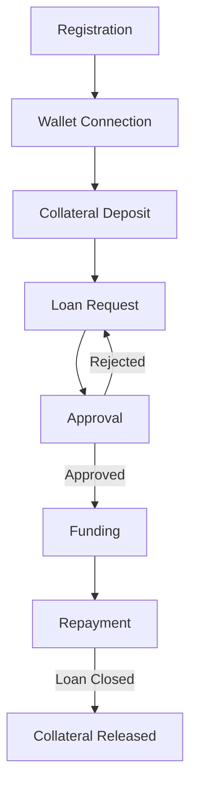

# User Guides

Welcome to the **Remitwise** user guides. This page is the starting point for anyone who wants to borrow using the protocol — whether you're taking out your first loan or looking for a specific reference guide.

The guides below walk you through the complete borrower journey, from creating an account all the way through repaying your loan. If you're new here, start at the top and work your way down. If you're looking for something specific, jump straight to the guide you need.

---

## The Borrower Journey

Borrowing on Remitwise follows a predictable, on-chain flow. Understanding the full journey up front will help you know what to expect at each stage:

1. **Registration** — Create your borrower profile and agree to the protocol terms.
2. **Wallet connection** — Connect a Stellar wallet (e.g. Freighter) so you can sign transactions.
3. **Collateral deposit** — Deposit the collateral required to back your loan.
4. **Loan request** — Submit a loan request specifying the amount and terms.
5. **Approval** — The protocol (and/or underwriters) reviews and approves your request.
6. **Funding** — The approved loan is funded and the principal is disbursed to you.
7. **Repayment** — Repay the loan according to the agreed schedule to close it out and release your collateral.

Each step is covered in detail in the guides linked below. The flow diagram shows how the steps connect.

### Flow Diagram

<!--
Fallback ASCII diagram (for renderers without Mermaid support):

    +--------------+     +-------------------+     +--------------------+
    | Registration | --> | Wallet Connection | --> | Collateral Deposit |
    +--------------+     +-------------------+     +--------------------+
                                                          |
                                                          v
    +------------+     +----------+     +--------------+
    | Repayment  | <-- | Funding  | <-- | Loan Request |
    +------------+     +----------+     +--------------+
          |                  ^                  |
          |                  |                  v
          |                  |            +----------+
          |                  +--(approve)-| Approval |
          |                               +----------+
          |                                    |
          |                              (reject) --> back to Loan Request
          v
    +---------------------+
    | Collateral Released |
    +---------------------+
-->

---

## Recommended Reading Order

Follow these guides in order for a smooth onboarding experience. Each one builds on the previous.

1. **[API Quickstart](api-quickstart.md)** — Get set up and make your first API calls.
2. **[Freighter Integration](freighter-integration.md)** — Connect your Stellar wallet and sign transactions.
3. **[Rate Limits](rate-limits.md)** — Understand request limits so your integration stays healthy.
4. **[Accessibility](accessibility.md)** — Learn about accessibility features and how to use them.

> If you're integrating programmatically, read the API Quickstart and Freighter Integration guides first. If you're using an existing client, you can skim those and focus on the journey steps above.

---

## Getting Started Checklist

New borrowers can follow this checklist step by step. Check off each item as you complete it.

- [ ] **Read this landing page** to understand the full borrower journey.
- [ ] **Complete the [API Quickstart](api-quickstart.md)** and confirm you can reach the API.
- [ ] **Install and set up a Stellar wallet** (e.g. Freighter) — see [Freighter Integration](freighter-integration.md).
- [ ] **Connect your wallet** to the protocol and verify your address is recognized.
- [ ] **Review [Rate Limits](rate-limits.md)** so you know how many requests you can make.
- [ ] **Deposit collateral** for the loan you intend to request.
- [ ] **Submit a loan request** with your desired amount and terms.
- [ ] **Wait for approval** and monitor the status of your request.
- [ ] **Confirm funding** and verify the principal was disbursed to your wallet.
- [ ] **Set a repayment schedule** and make your first repayment on time.
- [ ] **Repay the loan in full** and confirm your collateral is released.
- [ ] **Review [Accessibility](accessibility.md)** if you need assistive features or want to learn more.

---

## Need Help?

If you get stuck at any step, revisit the relevant guide above. Most issues during onboarding come from wallet connection or rate-limit problems, so those two guides are the best place to start troubleshooting.

Happy borrowing! 🚀