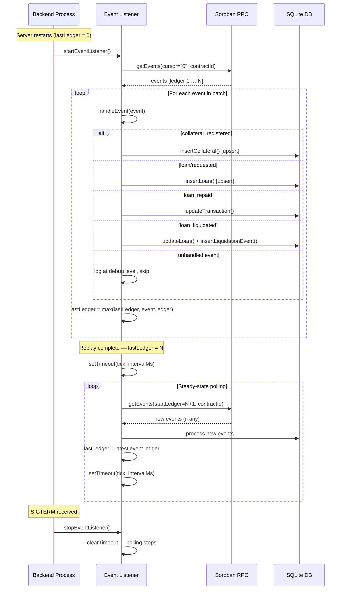

# Event Listener Lifecycle

The contract event listener polls the Soroban RPC for on-chain events and synchronises the local database. This guide documents how to safely start and stop the listener, how the ledger cursor is tracked and replayed on restart, and how to configure and reset the cursor manually.

The listener is implemented in [`backend/src/contractEventListener.ts`](../../backend/src/contractEventListener.ts).

---

## When the Listener Starts

The listener starts automatically during **server boot**, called from `backend/src/index.ts` after the database migrations have completed and the Express server is listening:

```typescript
// backend/src/index.ts (simplified)
await runDbMigrations();
server.listen(PORT, () => {
  logger.info("server_started", { port: PORT });
  startEventListener();   // ← starts the polling loop
});
```

`startEventListener()` validates that `CONTRACT_ID` is set. If it is not set, the listener logs a `event_listener_disabled` warning and returns immediately without starting — the rest of the server continues to function normally.

On successful start, the listener emits:
```json
{
  "message": "event_listener_started",
  "eventType": "contract.event.listener_started",
  "contractId": "C...",
  "intervalMs": 5000
}
```

---

## When the Listener Stops

The listener stops as part of the **graceful shutdown** sequence triggered by `SIGTERM` or `SIGINT` (e.g. `docker stop`, Kubernetes pod termination, or `Ctrl+C`). The shutdown handler in `backend/src/index.ts` calls `stopEventListener()` before draining in-flight HTTP requests:

```typescript
// backend/src/index.ts (simplified)
process.on("SIGTERM", async () => {
  stopEventListener();    // ← stops the polling loop
  server.close(async () => {
    await db.close();
    process.exit(0);
  });
});
```

`stopEventListener()` clears the internal `setTimeout` timer, sets the `pollTimer` reference to `null`, and emits:
```json
{
  "message": "event_listener_stopped",
  "eventType": "contract.event.listener_stopped",
  "contractId": "C...",
  "ledger": 12345
}
```

It is safe to call `stopEventListener()` multiple times (idempotent — a second call is a no-op if no timer is active).

---

## Polling Interval Configuration

The listener runs a `setTimeout`-based loop (not `setInterval`) so each poll waits for the previous one to complete before scheduling the next. This prevents RPC calls from piling up if the network is slow.

| Environment variable | Default | Description |
|---------------------|---------|-------------|
| `EVENT_POLL_INTERVAL_MS` | `5000` | Milliseconds between poll cycles |
| `EVENT_LISTENER_LOG_LEVEL` | `info` | Log verbosity: `debug`, `info`, `warn`, `error` |
| `EVENT_MAX_LOOKBACK_LEDGERS` | `17280` | Maximum ledger look-back when replaying missed events (see [Maximum Look-back Window](#maximum-look-back-window)) |

The interval can be overridden at startup:

```typescript
startEventListener(10_000); // poll every 10 seconds
```

Or via environment variable before starting the server:
```bash
EVENT_POLL_INTERVAL_MS=10000 npm start
```

**Recommendations:**

- **Testnet / development**: `5000 ms` (default) — low latency, acceptable RPC load.
- **Production mainnet**: `10000–30000 ms` — reduces RPC costs while still catching events within one ledger close (~5 s per ledger).
- **After a long outage / restart with full replay**: temporarily increase to `30000 ms` to throttle event ingestion and avoid memory pressure.

---

## Ledger Cursor: Persistence and Restoration

### How the cursor works

The listener tracks the last successfully processed ledger sequence number in a module-level variable:

```typescript
let lastLedger = 0; // in-memory only — resets to 0 on process restart
```

After processing each event in a poll cycle, the cursor advances:

```typescript
if (event.ledger > lastLedger) {
  lastLedger = event.ledger;
}
```

On each subsequent poll, `startLedger` is set to `lastLedger + 1`, so only new events are fetched:

```typescript
const eventsRequest = lastLedger > 0
  ? { startLedger: lastLedger + 1, filters: [...] }
  : { cursor: "0",                 filters: [...] };
```

### Persistence across restarts

The cursor is **in-memory only**. When the process exits, `lastLedger` is lost. On the next startup:

1. `lastLedger` resets to `0`.
2. The first poll issues `getEvents` with `cursor: "0"`, which instructs the Soroban RPC to replay **all historical events** for the contract from the genesis of its deployment.
3. The store functions (`insertCollateral`, `insertLoan`, `updateTransaction`, etc.) are **idempotent** — replaying an event that is already in the database performs an upsert, not a duplicate. Full replay is therefore safe, just slower on high-volume deployments.

For production deployments where full historical replay is too slow (thousands of events), the cursor should be stored in the database and restored on startup. This is not yet implemented; track the work in the relevant GitHub issue.

---

## Missed-Event Replay Algorithm

When the backend restarts after downtime, the listener automatically replays all events it may have missed. The algorithm is:

1. On startup `lastLedger` is `0`.
2. The first poll fetches all events (`cursor: "0"`) up to the RPC server's current ledger.
3. Each event is passed to `handleEvent()`, which performs the appropriate database write.
4. `lastLedger` is updated per event as processing completes.
5. The next poll starts from `lastLedger + 1`, fetching only events after the replay window.

Because the loop is sequential (each poll awaits all event processing before scheduling the next tick), no events are skipped and no events are processed out of order.

### Sequence Diagram



---

## Maximum Look-back Window

The Soroban RPC retains historical event data for a configurable number of ledgers. By default, public RPC endpoints keep approximately **17 280 ledgers** of history (roughly 24 hours at ~5 seconds per ledger). Once an event falls outside this window, it is no longer accessible via `getEvents`.

| Parameter | Default | Meaning |
|-----------|---------|---------|
| `EVENT_MAX_LOOKBACK_LEDGERS` | `17280` | Ledger depth to request on the first replay poll |
| Approximate wall-clock coverage | ~24 hours | At 5 s/ledger × 17 280 ledgers |
| Public testnet RPC retention | ~17 280 ledgers | Varies by operator; check the RPC provider's docs |
| Self-hosted RPC (`stellar-core`) | Configurable | Set `HISTORY_RETENTION_COUNT` in stellar-core config |

**Implications for operators:**

- If the backend is down for fewer than 24 hours, a restart will replay all missed events from the RPC history without data loss.
- If the backend is down for more than 24 hours (or the RPC's retention window), events older than the window are no longer retrievable via the RPC. Those gaps must be recovered from an archival source (e.g. Stellar Horizon's ledger export or a third-party indexer).
- To increase the effective look-back window, either reduce downtime or run a self-hosted Stellar Core node with a larger `HISTORY_RETENTION_COUNT`.

---

## Sequence: Startup and Shutdown

```
Server process start
│
├─ runDbMigrations()          — apply any pending DB migrations
├─ server.listen(PORT)        — begin accepting HTTP connections
└─ startEventListener()       — begin polling loop
      │
      └─ tick()               — first poll (lastLedger = 0, full replay)
            │
            ├─ poll()         — RPC call: getEvents(cursor="0", ...)
            ├─ handleEvent()  — process each returned event (upsert to DB)
            ├─ lastLedger = N — advance cursor to highest processed ledger
            └─ setTimeout(tick, 5000)  — schedule next poll
                  │
                  └─ ... repeats ...

SIGTERM / SIGINT received
│
├─ stopEventListener()        — clearTimeout(pollTimer)
├─ server.close()             — stop accepting new connections
├─ drain in-flight requests   — wait up to SHUTDOWN_TIMEOUT_MS
└─ process.exit(0)
```

---

## Error Handling

| Error type | Behaviour |
|-----------|-----------|
| RPC network error | Logged as `contract.event.poll_error`; listener schedules next poll normally (does not crash) |
| Event parse error | Logged as `contract.event.parse_error`; the failing event is skipped; listener continues |
| `CONTRACT_ID` unset | `startEventListener()` logs `event_listener_disabled` and returns; listener never starts |
| `stopEventListener()` called twice | No-op; safe |
| DB write error | Logged as `contract.event.parse_error`; the event is skipped; cursor does not advance past the failed event |

The listener **never throws** to the caller. All errors are caught internally and logged as structured entries.

---

## Manual Control (Development / Testing)

The listener can be started and stopped programmatically without a full server restart:

```typescript
import { startEventListener, stopEventListener } from './contractEventListener';

// Start with a custom interval
startEventListener(2000);

// Stop (e.g. in test teardown)
stopEventListener();
```

In tests, `stopEventListener()` is called in `afterEach`/`afterAll` to prevent timer leaks between test cases.

---

## Runbook: Manually Resetting the Ledger Cursor

Use this runbook when you need to force a full event replay — for example after a schema migration that requires re-deriving database state from on-chain history, or after suspecting the cursor advanced past a corrupt write.

### When to use this

- A DB migration changed how events are stored and you need to re-process history.
- The local database was corrupted or accidentally wiped.
- You suspect a bug caused the cursor to advance past events that were not written correctly.
- You want to test the replay path in production without code changes.

### Prerequisites

- SSH access to the backend host (or `kubectl exec` into the pod).
- Ability to restart the backend process or container.
- The RPC endpoint still has the history you need (see [Maximum Look-back Window](#maximum-look-back-window) — events older than ~24 hours may no longer be accessible).

### Steps

**1. Stop the backend gracefully.**

```bash
# Docker Compose
docker compose stop backend

# Kubernetes
kubectl rollout pause deployment/stellarkraal-backend
kubectl scale deployment/stellarkraal-backend --replicas=0
```

Wait for in-flight requests to drain (the graceful shutdown timeout is `SHUTDOWN_TIMEOUT_MS`, default 10 000 ms).

**2. (Optional) Clear derived state if re-processing requires it.**

If a schema migration changed how events map to rows, truncate the affected tables before replay so stale rows are not left behind:

```bash
# Example: wipe and re-derive liquidation events only
sqlite3 /data/stellarkraal.db "DELETE FROM liquidation_events;"
```

> **Warning**: this is a destructive operation. Take a database snapshot first:
> ```bash
> cp /data/stellarkraal.db /data/stellarkraal.db.bak-$(date +%Y%m%dT%H%M%S)
> ```

**3. Reset the cursor.**

The cursor is entirely in memory and resets to `0` automatically on restart. No file or database row needs to be changed. Simply proceed to the next step.

If a future version of the listener persists the cursor to the database (see the note in [Ledger Cursor: Persistence and Restoration](#ledger-cursor-persistence-and-restoration)), reset it with:

```bash
sqlite3 /data/stellarkraal.db "UPDATE listener_state SET last_ledger = 0 WHERE id = 1;"
```

**4. Restart the backend with a wider look-back (optional).**

If the downtime was longer than the default look-back window, increase `EVENT_MAX_LOOKBACK_LEDGERS` to cover the gap:

```bash
# Approximately 48 hours of history
EVENT_MAX_LOOKBACK_LEDGERS=34560 docker compose up -d backend
```

**5. Verify replay is running.**

Tail the logs and confirm:

- `event_listener_started` appears with `lastLedger: 0` (or the reset value).
- `contract.event.received` entries appear immediately on the first tick.
- The `ledger` field in log entries climbs monotonically from the oldest available ledger toward the current chain head.
- No sustained stream of `contract.event.poll_error` entries (which would indicate the RPC is unavailable or rate-limiting).

```bash
docker compose logs -f backend | grep '"eventType"'
```

Expected first-tick output:

```json
{ "eventType": "event_listener_started", "contractId": "C...", "intervalMs": 5000, "lastLedger": 0 }
{ "eventType": "contract.event.received", "ledger": 1234, ... }
{ "eventType": "contract.event.received", "ledger": 1235, ... }
...
```

**6. Monitor until caught up.**

The replay is complete when the `ledger` values in `contract.event.received` entries match the current chain head. At that point the listener switches to steady-state polling and the gap between ledger values should equal roughly `EVENT_POLL_INTERVAL_MS / 5000` (one new ledger per ~5 seconds).

**7. Scale back up (Kubernetes).**

```bash
kubectl scale deployment/stellarkraal-backend --replicas=1
kubectl rollout resume deployment/stellarkraal-backend
```

### Troubleshooting

| Symptom | Likely cause | Resolution |
|---------|-------------|------------|
| No `contract.event.received` entries after start | `CONTRACT_ID` unset or wrong; RPC unreachable | Check env vars; `curl $RPC_URL` |
| `contract.event.poll_error` on every tick | RPC rate limiting or network outage | Increase `EVENT_POLL_INTERVAL_MS`; check RPC status |
| Replay stops at a certain ledger and doesn't advance | Events beyond that ledger exceed the RPC retention window | Increase `EVENT_MAX_LOOKBACK_LEDGERS` or use an archival source |
| DB rows are duplicated after replay | Store functions are not fully idempotent | File a bug; check `insertCollateral` / `insertLoan` upsert logic |
| `lastLedger` advances but new events are still missing | Cursor persisted to DB (future feature) but DB row not reset | Reset the `listener_state` row (step 3 above) |

---

## Related

- [`contractEventListener.ts`](../../backend/src/contractEventListener.ts) — source code
- [`contractEventListener.test.ts`](../../backend/src/contractEventListener.test.ts) — unit tests
- [Contract Event Listener Architecture](contract-event-listener.md) — polling architecture, event types, and DB sync details
- [Observability Stack](../observability.md) — how listener logs flow to Loki/Grafana
- [High Memory Runbook](../runbooks/high-memory.md) — diagnosing memory growth caused by event replay
